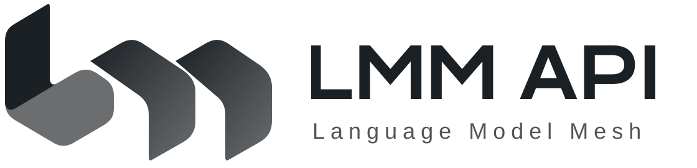

<div align="center">
  
  <h1>LMM API</h1>
  <p>LMM API · 连接模型与工具，让智能自由流动</p>
  <p><a href="LICENSE"></a></p>
  <p><a href="README.md">简体中文</a> · <a href="README_EN.md">English</a></p>
</div>

**LMM（Language Model Mesh）是模型网关与业务扩展平台。** Core 统一管理账号、权限、余额和模型调用；商店、工具、助手与支付适配由扩展承载。

> 新架构仍在开发与验收中。当前进度只维护在 [新架构进度](docs/progress.md)；源码存在、模块测试通过、打包和生产切换分别核实。

## 三个程序

| 程序 | 源码 | 职责 |
| --- | --- | --- |
| `lmm-core` | [services/core](services/core) | 身份、权限、计费、账本和模型路由；独立于 Go 运行 |
| `lmm-extensions` | [services/extensions](services/extensions) | 商店、工具、助手、运营与支付适配；仅访问自己的业务数据库 |
| `lmm` | [apps/cli](apps/cli) | 独立维护的客户端，通过子模块固定版本 |

Core 是资金和权限的唯一权威；扩展通过授权 RPC 请求核心操作。`apps/web` 构建为静态文件，由 Web 服务器托管。边界与数据库合同见[架构指南](docs/core-migration.md)。

## 开发与安装

工具版本由 [mise.toml](mise.toml) 固定，按任务准备依赖并使用 `mise exec --`。详细命令见[开发指南](docs/development.md)，隔离环境见 [Docker 开发栈](deployment/docker/README.md)。

全新核心数据库由独立的安装 owner 显式初始化，运行凭据不具备建表权限：

```sh
lmm-core --config /absolute/private/core-owner.toml init-db
lmm-core --config /absolute/private/core.toml check-db
```

配置默认使用 `/etc/lmm.conf.d/core.toml` 和 `extensions.toml`。秘密、持久状态与运行目录的所有权见[文件路径规范](docs/filesystem-layout.md)和 [PostgreSQL 指南](deployment/postgres/README.md)。已有站点的迁移须按经过验收的专项方案执行。

## 文档入口

| 内容 | 入口 |
| --- | --- |
| 剩余工作、关闭条件与验收状态 | [新架构进度](docs/progress.md) |
| 稳定设计、配置与业务指南 | [文档目录](docs/README.md) |
| 开发检查与独立验收 | [工作指南](docs/agent-workflows.md)、[质量指南](docs/quality.md) |
| 打包、制品与升级边界 | [发布架构](docs/release-architecture.md) |
| 用户、隐私和退款协议 | [协议模板](docs/legal/README.md) |
| 旧记录、失败证据与来源 | [历史索引](docs/archive.md) |

## 协作与来源

源码在本仓库 `main` 开发；[配方仓库](https://github.com/TokenNotIncluded/lmm-api)通过 gitlink 固定源码。[分支规则](docs/development.md#仓库与主线)说明当前主线与旧稳定发布的关系。[Extore 集成](docs/extore.md)的自动部署限制继续生效。

参与前阅读[贡献指南](docs/agent-workflows.md#贡献与交付)。安全问题通过[安全政策](.github/SECURITY.md)报告，请勿公开密钥或用户数据。

本项目源自 [QuantumNous/new-api](https://github.com/QuantumNous/new-api)，按 [AGPL-3.0](LICENSE) 发布。保留 [NOTICE](NOTICE)、[来源与归属](docs/core-migration.md#来源与许可)及[第三方许可证](THIRD-PARTY-LICENSES.md)。[线上服务](https://api.lmm.best)的版本需独立核实。
