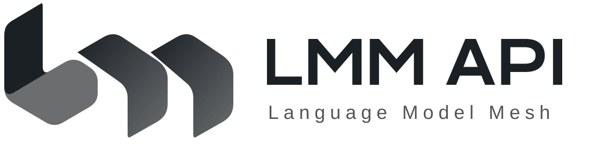

  
  <h1>LMM API</h1>
  
LMM API · 连接模型与工具，让智能自由流动

  

  
<a href="README.md">简体中文</a> · <a href="README_EN.md">English</a>

**LMM（Language Model Mesh）是模型网关与业务扩展平台。** 新架构仍在验收，[进度表](docs/progress.md)记录各项验收结果和待办。[线上服务](https://api.lmm.best)的版本需单独核实。

## 三个程序

| 程序 | 职责 |
| --- | --- |
| [`lmm-core`](services/core) | 独立于 Go 运行，是身份、权限、资金账本与模型路由的权威 |
| [`lmm-extensions`](services/extensions) | 用独立数据库承载商店、工具、助手和支付适配，经授权 RPC 调用 Core |
| [`lmm`](apps/cli) | 独立维护的命令行客户端，由本仓库的子模块固定版本 |

[Web 控制台](apps/web)构建为静态文件，由 Web 服务器托管。各组件的数据归属见[架构指南](docs/core-migration.md)。

## 开发与安装

| 要做的事 | 从这里开始 |
| --- | --- |
| 开发或启动隔离环境 | [按组件准备工具](docs/development.md#只准备所需工具) · [Docker 开发栈](deployment/docker/README.md) |
| 安装全新 Core 数据库 | [安装 owner 执行 `init-db`，运行账号执行 `check-db`](docs/development.md#核心与数据库) · [角色与授权](deployment/postgres/README.md) · [配置路径](docs/filesystem-layout.md) |
| 打包、升级已有站点或处理切换失败 | [发布架构](docs/release-architecture.md) · [原生切换与恢复](deployment/native/README.md#cutover-after-migration-is-qualified) |

## 文档入口

[业务与接口目录](docs/README.md) · [质量与独立验收](docs/quality.md) · [用户、隐私和退款协议](docs/legal/README.md) · [历史与失败证据](docs/archive.md)

## 协作与来源

本仓库在 `main` 开发，[配方仓库](https://github.com/TokenNotIncluded/lmm-api)固定源码提交。协作前请读[分支规则](docs/development.md#仓库与主线)、[贡献指南](docs/agent-workflows.md#贡献与交付)及 [Extore 部署限制](docs/extore.md)。安全问题按[安全政策](.github/SECURITY.md)私下报告。

本项目源自 [QuantumNous/new-api](https://github.com/QuantumNous/new-api)，按 [AGPL-3.0](LICENSE) 发布。详见 [NOTICE](NOTICE)、[来源与归属](docs/core-migration.md#来源与许可)及[第三方许可证](THIRD-PARTY-LICENSES.md)。
