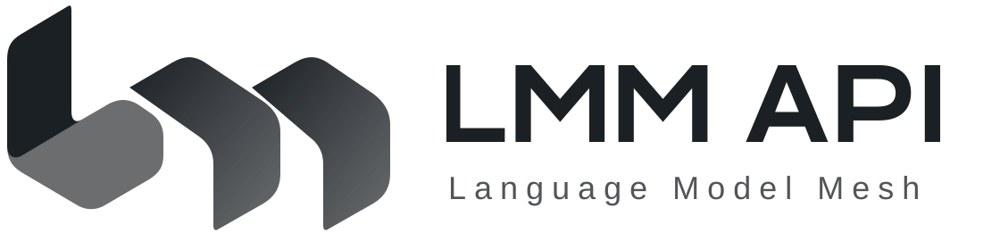

  
  <h1>LMM API</h1>
  
LMM API · Tool marketplace and AI ecosystem

  

  
<a href="README.md">简体中文</a> · <a href="README_EN.md">English</a>

**LMM (Language Model Mesh) is an AI tool marketplace for individuals and teams.** Discover MCP tools, authorize an assistant, set a budget for its calls, and review its usage. AI assistants, the CLI, and business plugins share Core’s identity, permissions, and account system.

The new architecture is under evaluation. [Architecture progress](docs/progress.md) tracks acceptance results and remaining work. Verify the version of the [hosted service](https://api.lmm.best) separately.

## Three programs

| Program | Responsibility |
| --- | --- |
| [`lmm-core`](services/core) | Owns identity, permissions, the financial ledger and model routing. Runs independently of Go. |
| [`lmm-extensions`](services/extensions) | Runs the store, tools, assistant and payment adapters with its own database. Calls Core over authorized RPC. |
| [`lmm`](apps/cli) | Separately maintained command-line client, pinned as a submodule. |

A Web server serves the static [Web console](apps/web). See the [architecture guide](docs/core-migration.md) for data ownership.

## Development and installation

| Task | Start here |
| --- | --- |
| Develop or start an isolated environment | [Tools by component](docs/development.md#只准备所需工具) · [Docker development stack](deployment/docker/README.md) |
| Install a fresh Core database | [Run `init-db` as the installation owner and `check-db` as the runtime role](docs/development.md#核心与数据库) · [Roles and grants](deployment/postgres/README.md) · [Configuration paths](docs/filesystem-layout.md) |
| Package a release, upgrade an existing site or recover from a failed cutover | [Release architecture](docs/release-architecture.md) · [Native cutover and recovery](deployment/native/README.md#cutover-after-migration-is-qualified) |

## Documentation

[Business and API guides](docs/README.md) · [Quality and independent acceptance](docs/quality.md) · [User, privacy and refund policies](docs/legal/README.md) · [Archive and failure evidence](docs/archive.md)

## Contributing and provenance

Development uses `main`. The [recipe repository](https://github.com/TokenNotIncluded/lmm-api) pins the source commit. See the [branch policy](docs/development.md#仓库与主线), [contribution guide](docs/agent-workflows.md#贡献与交付) and [Extore deployment restrictions](docs/extore.md). Report vulnerabilities privately under the [security policy](.github/SECURITY.md).

This project derives from [QuantumNous/new-api](https://github.com/QuantumNous/new-api) and is licensed under [AGPL-3.0](LICENSE). See [NOTICE](NOTICE), [provenance](docs/core-migration.md#来源与许可) and [third-party licenses](THIRD-PARTY-LICENSES.md).
