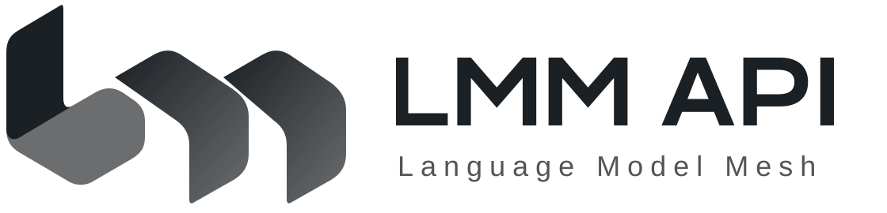

<div align="center">
  
  <h1>LMM API</h1>
  <p>LMM API · Connecting models and tools, letting intelligence flow freely</p>
  <p><a href="LICENSE"></a></p>
  <p><a href="README.md">简体中文</a> · <a href="README_EN.md">English</a></p>
</div>

**LMM (Language Model Mesh) is a model gateway and business extension platform.** Core owns accounts, permissions, balances and model requests. Extensions provide the store, tools, assistant and payment adapters.

> The new architecture remains under development and acceptance. [Architecture progress](docs/progress.md) is the only current tracker. Source implementation, module checks, packaging and production cutover require separate evidence.

## Three programs

| Program | Source | Responsibility |
| --- | --- | --- |
| `lmm-core` | [services/core](services/core) | Identity, permissions, billing, ledger and model routing; runs independently of Go |
| `lmm-extensions` | [services/extensions](services/extensions) | Store, tools, assistant, operations and payment adapters; accesses only its own business database |
| `lmm` | [apps/cli](apps/cli) | Separately maintained client, pinned as a submodule |

Core is the sole authority for funds and permissions. Extensions request core operations through authorized RPC. `apps/web` builds static files for a Web server to serve. See the [architecture guide](docs/core-migration.md) for ownership and database contracts.

## Development and installation

[mise.toml](mise.toml) pins tool versions. Prepare dependencies for the task and run tools with `mise exec --`. See [Development](docs/development.md) for commands and the [Docker development stack](deployment/docker/README.md) for an isolated environment.

A separate installation owner explicitly initializes a new core database. Runtime credentials cannot create tables:

```sh
lmm-core --config /absolute/private/core-owner.toml init-db
lmm-core --config /absolute/private/core.toml check-db
```

Default configuration paths are `/etc/lmm.conf.d/core.toml` and `extensions.toml`. Secret, persistent-state and runtime-directory ownership are defined in the [filesystem guide](docs/filesystem-layout.md) and [PostgreSQL guide](deployment/postgres/README.md). Existing-site migration requires its own accepted procedure.

## Documentation

| Topic | Entry |
| --- | --- |
| Remaining work, closure criteria and acceptance status | [Architecture progress](docs/progress.md) |
| Stable design, configuration and business guides | [Documentation index](docs/README.md) |
| Development checks and independent acceptance | [Working guide](docs/agent-workflows.md), [Quality guide](docs/quality.md) |
| Packaging, artifacts and upgrade boundaries | [Release architecture](docs/release-architecture.md) |
| User, privacy and refund policies | [Policy templates](docs/legal/README.md) |
| Historical records, failure evidence and provenance | [Archive](docs/archive.md) |

## Contributing and provenance

Implementation work uses this repository's `main`. The [recipe repository](https://github.com/TokenNotIncluded/lmm-api) pins source through a gitlink. The [branch policy](docs/development-branches.md) distinguishes the active mainline from the legacy stable release. The automatic-deployment restriction for [Extore integration](docs/extore.md) remains in effect.

Read the [contribution guide](docs/contributing.md) before making changes. Report vulnerabilities through the [security policy](.github/SECURITY.md); never publish keys or user data.

This project derives from [QuantumNous/new-api](https://github.com/QuantumNous/new-api) and is released under [AGPL-3.0](LICENSE). Preserve [NOTICE](NOTICE), [fork provenance](docs/fork.md) and [third-party notices](THIRD-PARTY-LICENSES.md). The version of the [hosted service](https://api.lmm.best) must be verified separately.
