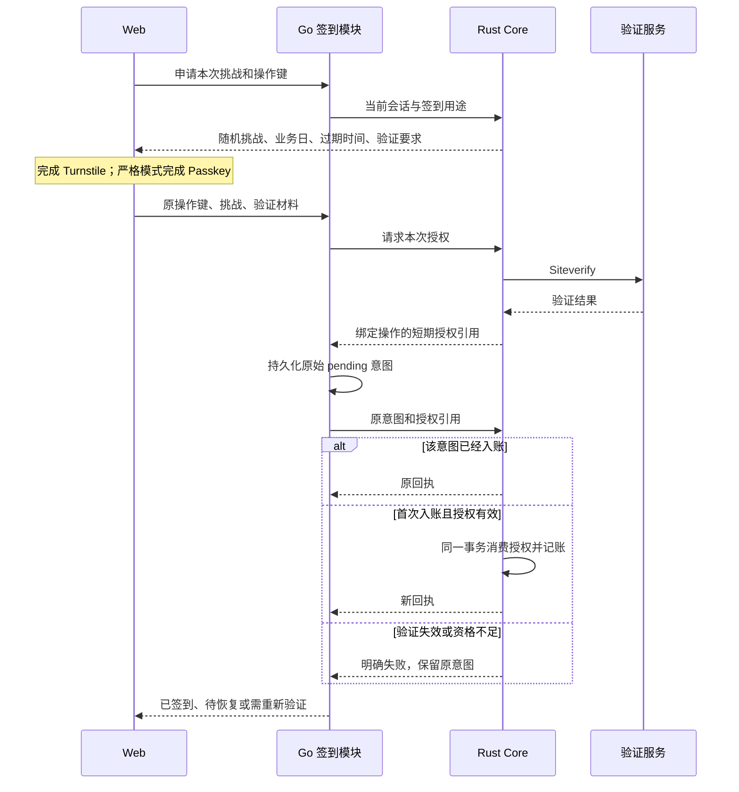

# 签到防自动化设计

[文档目录](README.md) · [滥用防护](abuse-controls.md) · [核心身份](core-identity.md)

日期：2026-11-15（UTC+8）。状态：设计建议，尚未实施或进行防护效果测试。
源码核查基线：`1eba304af1f3f9d5c1a834e599e853e4e7bcc4de`。

## 设计结论与范围

建议保留稳定接口，将随机性放在每次领取的短期挑战上，并由 Core 验证挑战、
限制领取次数和原子记账。日常模式要求每次领取完成 Turnstile；严格模式再要求
当次 Passkey 确认。严格模式更接近“每天都需要用户确认”的交互目标，普通
Passkey 的来源可信度仍决定它的实际防自动化强度。

开放网页的客户端由用户控制。浏览器能读取新 URL、参数和 JavaScript，自动化
浏览器也能读取相同信息。每天随机更换接口仅影响写死地址的脚本；一次性挑战
解决预先保存请求和跨场景重放，脚本仍能申请新的挑战。最终目标应当是阻断简单
定时 HTTP 调用、提高完整浏览器自动化及批量领取成本，并保证重复请求不重复发奖。
具体拦截率需要实施后测量。[1]

本文依次定义现有落点、交互协议、验证边界、资金一致性、用户体验和验收方法。
以下参数是初始建议，产品上线前按真实完成率及误伤情况调整。

| 方案 | 对普通用户的影响 | 适用边界 |
| --- | --- | --- |
| 每天更换 URL 或字段名 | 可能出现旧页面失效 | 写死地址的脚本失效；动态发现脚本可适配 |
| 随机挑战 + 每次 Turnstile + 统一发奖约束 | 点击签到，按需显示验证组件 | 作为基础防护；自动通过检测的浏览器仍可能成功 |
| 基础防护 + 每次 Passkey 确认 | 每天通过设备指纹、面容、PIN 或安全密钥确认 | 提高常规无人值守脚本成本；依赖认证器可信度 |
| 受信认证器证明及硬件策略 | 设备兼容、注册与恢复成本较高 | 需要较强设备信任的封闭场景，小额公众奖励不宜默认采用 |

## 现有实现与接入点

以下是冻结源码的事实，生产路由与运行配置需要在实施时核对。

| 模块 | 已有能力 | 本次设计的接入点 |
| --- | --- | --- |
| [Web 签到 API](../apps/web/src/features/profile/api.ts) | 以 `operation_key` 提交日签；有 Turnstile 参数传递 | 增加挑战请求；验证材料放 JSON 正文；保留操作恢复 |
| [Go HTTP](../services/extensions/internal/modules/checkins/http.go) | 日签状态、能力与提交接口；非空 Turnstile 参数当前返回不可用 | 接入验证协议和明确的验证错误；统一入口约束 |
| [Go Service](../services/extensions/internal/modules/checkins/service.go) | 先保存 `pending` 意图，再调用 Core，最后保存 `settled` 回执 | 首次意图关联 Core 验证结果；保留原金额、日期和操作键 |
| [Go Schema](../services/extensions/internal/modules/checkins/schema.sql) | `PRIMARY KEY(account_id,day)`、`UNIQUE(user_id,day)` | 保留每日唯一性，随机挑战不进入奖励去重键 |
| [Core CheckinLedger](../services/core/src/checkin_ledger.rs) | 个人 Session、金额上限、UTC+8 日切、固定日签账本键 | 首次发奖强制核验并消费授权；已有结果继续幂等返回 |
| [Core Turnstile](../services/core/src/config/turnstile_config.rs) | 有界 Siteverify HTTP 客户端及 hostname 检查 | 增加 action、cdata 绑定和签到强制验证语义 |
| [Core Passkey](../services/core/src/identity/browser/passkeys.rs) | 注册、登录、服务端 flow 与成熟 WebAuthn 实现 | 新增签到用途的二次确认；严格要求 UV，独立于登录兼容策略 |

日签与 [Core 促销活动签到](../services/core/src/promotions/http.rs)有独立业务语义。
促销路由按活动计奖，并使用 UTC 日期；现有 Extensions 日签使用 UTC+8。
如果某活动提供同一份每日奖励，应统一其奖励身份、日切和验证要求；独立活动保持
各自合同。存在一个路由定义并不说明生产正在启用它。

## 交互与接口

正常交互保持一个固定的“签到”按钮。用户点击后获取本次挑战，浏览器完成所需
验证，再提交领取。失败时刷新挑战；请求结果未知时查询原操作。按钮位置、页面
结构和每日开放时间保持可预测，避免用界面不稳定增加用户负担。



图中接口和 RPC 是拟议合同；授权检查应在首次发奖处成立。实现时可在 Go 入口
先恢复已完成操作，跳过不必要的验证调用。验证材料仅用于本次操作，Core 不接受
客户端或 Go 提交一个裸的 `verified=true` 作为证明。

### 稳定 API 与随机挑战

| 接口 | 拟议职责 |
| --- | --- |
| `GET /api/user/checkin` | 保留状态和历史查询；返回服务端业务日 |
| `POST /api/user/checkin/challenges` | 为当前会话及 `operation_key` 创建短期挑战 |
| `POST /api/user/checkin` | 提交挑战和验证材料，领取或恢复原操作 |

挑战入口只接受个人交互会话，保持现有 API Key 拒绝语义。挑战使用安全随机数
发生器生成至少 128 位熵，建议 32 字节。初始有效期为 120 秒，过期可重新获取。
客户端提交的用户 ID、日期、风险级别和奖励金额均不作为权威输入。

Core 保存以下关联：

| 字段 | 用途 |
| --- | --- |
| `challenge_id` | 随机挑战标识；服务端可保存其摘要 |
| `user_id`、`account_id` | 由认证结果确定领取主体 |
| `session_binding`、`auth_version` | 绑定当前会话及撤销状态，不向验证服务发送原始会话凭证 |
| `purpose`、`reward_scope` | 固定本次签到用途及奖励范围 |
| `business_day` | Core 按现有 UTC+8 合同计算 |
| `operation_key` | 绑定客户端原始重试操作；不承担每日去重职责 |
| `policy_version`、`required_verification` | 固定服务端选择的防护策略，客户端无权降低 |
| `issued_at`、`expires_at`、`state` | 限制有效期并记录授权消费 |

挑战返回示意：

```json
{
  "challenge_id": "example-opaque-challenge-id",
  "business_day": "2026-11-15",
  "expires_in": 120,
  "required_verification": ["turnstile", "passkey"],
  "turnstile_action": "daily_checkin",
  "turnstile_cdata": "example-opaque-binding"
}
```

实际严格模式响应还要包含现有 WebAuthn 库产生的认证选项；示意值不可用于生产。
申请挑战时绑定 `operation_key`，提交时必须相同。刷新挑战不得创建新的每日奖励
或重新抽奖。跨日未完成的挑战失效，用户按新的服务端业务日重新发起签到。

如果产品明确要随机 URL，可以返回 `/api/user/checkin/claim/{challenge_id}`。
其内部仍使用同一个路由处理器和完整授权检查，安全收益来自挑战合同。随机路径
会进入访问日志，应避免在路径携带可单独授权领奖的秘密；优先选择 JSON 正文。

### Turnstile 验证

每次新的领取都调用服务端 Siteverify，并检查 `success`、精确 hostname、
`action=daily_checkin`，以及 `cdata` 是否匹配本次服务端挑战记录。`cdata` 使用
无个人信息的随机关联标识，其作用是防止上下文串用，身份仍来自当前会话。
密钥只保存在服务端，前端成功回调不直接触发发奖。[2]

Turnstile 令牌有效期为 300 秒，业务挑战仍按本方案更短的有效期执行。官方明确
说明重复令牌检测存在最终一致性窗口，相近请求可能都通过 Siteverify，因此 Core
仍需独立完成一次性消费和账本幂等。[2]

复用现有验证客户端时，应单独定义“签到验证必需”的调用语义。当前配置缺省时
放行的可选验证语义不适用于强制签到模式。配置缺失、供应商超时或不可达时返回
签到暂不可用，不能自动移除验证要求。已入账回执查询仍应正常恢复。

### 每次 Passkey 确认

严格模式每次签到使用全新 WebAuthn challenge，设置 `userVerification=required`，
并由服务端校验 challenge、签名、凭据归属、origin、RP ID、UP 和 UV。签到使用
独立用途及会话绑定，不复用“此前登录成功”或长期“已验证”状态。沿用现有
WebAuthn 库，不自行编写签名和认证器解析协议。[3]

在可信设备上，这通常意味着一次指纹、面容、PIN 或安全密钥确认。WebAuthn
也允许软件认证器；没有可验证来源证明时，服务端获得的保障取决于认证器行为。
普通 Passkey 因而适合提高无人值守自动化成本，不能独立提供所有用户都是真人
操作的结论。更强要求需要注册阶段的受信 attestation、认证器策略及匹配的恢复
流程；这些会增加兼容性和维护负担。[3]

严格模式没有弱验证自动回退。尚未绑定凭据的用户先注册，设备不可用时走明确
恢复流程，必要时暂缓领取。验证码、邮箱或 TOTP 不可被描述为同等强度的人工
在场证明。凭据恢复与重新注册也应受风险策略约束，防止绕开每日确认要求。

## 资金一致性与恢复

签到的随机挑战和账本幂等承担不同职责。挑战限制本次授权，固定业务键限制每天
最多发放一次。保留以下现有约束：

- Go：`PRIMARY KEY(account_id, day)` 和 `UNIQUE(user_id, day)`。
- Core：scope 为 `core-checkins`，资金键为 `daily:{account_id}:{day}`。
- 客户端变更 `operation_key`、挑战或策略版本，均不产生新的每日资格。
- 独立活动使用稳定的活动身份做去重；同一奖励的不同入口共享同一业务身份。

PostgreSQL 的唯一约束适合承担这种跨请求的唯一性要求；应用内标志位和先查后写
流程还需要数据库约束配合。[4] 若引入活动级唯一键，所有组成列应非空，且不得
将随机挑战或可变化的策略版本加入“每天一次”的唯一键。

### Core 事务边界

外部验证码调用在数据库短事务之外完成。成功结果在 Core 记录为短期、一次性、
绑定当前用户、会话、日期、用途及原操作的授权。Go 仅持有授权引用。首次
`CheckinLedger.Post` 在同一个 Core 事务内重新确认权限、期限和业务关联，消费
授权、执行原日签记账，并关联原回执。

如果该资金意图已有不可变账本结果，认证通过后直接返回原回执，沿用既有实现中
“先恢复已提交结果”的语义。过期或已消费挑战不得使已经到账的结果变成失败。
零额度签到也要有明确的已消费状态和结果，防止只在正金额路径记录消费。

Go 与 Core 使用不同数据库。继续采用当前的“持久化意图 → 幂等 RPC → 保存
回执”，不把跨进程流程描述为一个数据库事务。授权引用和原意图的关联必须可
恢复；Go 无权直接写 Core 的挑战状态、余额或账本。

### 失败与重试的确定行为

| 情况 | 恢复行为 |
| --- | --- |
| 验证失败，尚未创建意图 | 返回可理解的验证错误，允许重新获取挑战 |
| 验证成功，Go 保存意图前崩溃 | 原挑战仍有效时恢复；否则重新验证 |
| Go 已保存 pending，Core 尚未入账 | 使用原日期、金额和操作继续；授权过期时为同一意图重新验证 |
| Core 入账成功，RPC 响应丢失 | 按原固定日签键恢复回执，不再次消费或发奖 |
| Go 保存 settled 前崩溃 | 取回 Core 原回执并完成业务状态 |
| 并发提交多个有效挑战 | 每日唯一约束及 Core 事务使最终奖励只有一笔 |
| 跨日后首次发放未完成 | 遵守现有日切授权规则；不依客户端旧日期补发 |

“pending”本身不是验证凭证。上线前遗留的 pending，只有已存在 Core 发奖回执
或符合新授权规则的记录可恢复；缺少验证的历史 pending 不应被自动批准。刷新
授权时保留已抽取金额，不能通过重试挑选更高奖励。现有意图表不可变触发器需要
在实施时纳入设计，可在独立关联记录中保存新验证引用，避免改写原始资金意图。

## 风控、预算与正常体验

基础限流采用用户和网络的独立计数。初始可设置每用户每分钟最多申请 5 次挑战，
每次挑战最多 3 次失败提交；它们是待观测的建议值。网络计数作为共享出口感知的
辅助措施，超限优先冷却或升级验证。一天只请求一次的脚本不会被合理的频率限制
单独拦住，所以限流主要保护资源和限制批量尝试。[1]

判断批量滥用时优先使用服务端已有记录：短时间集中注册、多个账号的关联行为、
领取与正常产品使用的比例、已确认的滥用历史和异常重试。固定签到时间、同一个
IP、缺少鼠标轨迹、使用无障碍工具均不足以单独决定封禁。记录必要的结果与原因
码，不保存原始验证码、Cookie、Passkey 私钥或大范围行为轨迹。

每日活动预算、账户奖励上限及奖励用途约束控制经济损失。预算扣减必须由拥有
资金权限的 Core 原子执行。任何额度有效期、提现或转赠规则的改变都应作为单独
产品政策评估，保持用户已获得权益。收益与成本的具体数值需要业务数据，不能凭
估计宣称脚本已经无利可图。

用户界面只展示当前可采取的操作：签到、完成验证、重新验证、正在确认结果、
今日已签到。避免随机移动按钮、隐藏入口、强制等待、鼠标轨迹游戏和随机开放时段。
错误说明应区分验证失败、网络暂时不可用和结果未知，防止用户反复点击制造新意图。

Cookie 自动附带的入口应按现有身份架构落实 CSRF 保护；Bearer 入口继续使用明确
的认证绑定及跨域策略。Origin、Referer、CORS 或前端点击事件只是各自边界内的
防护，独立脚本可以构造请求，不能用这些信号作为人工签到证明。

## 实施顺序

1. **补齐实际验证链。** 基于现有 Core Siteverify 客户端接入签到，验证材料移到
   JSON 正文，增加用途和上下文核验；保留当前状态查询和幂等行为。
2. **加入挑战及 Core 授权消费。** 扩展日签 RPC 合同、Go 意图关联及 Web 请求；
   先保证缺少有效授权时没有新的资金效果。
3. **落实严格模式。** 增加签到专用 Passkey 确认，覆盖凭据注册、设备恢复和
   缺少能力时的交互。按产品选择对所有新领取执行，或仅对风险账号执行。
4. **覆盖实际发奖入口。** 核对生产代理分流、兼容入口及相关 promotions 活动，
   确保同一奖励走同一授权和去重约束。旧入口不得继续独立发放同一奖励。
5. **灰度观察并收敛参数。** 先看正常完成率及验证耗时，再调整挑战期限和限流；
   回滚时保留账本约束，验证依赖故障时暂缓签到发奖。

以上是实施建议，不包含生产配置变更或发布动作。随机 URL 仅在产品确有需求时
作为薄层加入，不作为防护验收依据。

## 验收方法与待测指标

实施时使用合成账号、隔离数据库和供应商测试配置。真实供应商拦截效果另做受控
测试，不用固定通过的 mock 推导真实反自动化效果。

| 用例 | 验收结果 |
| --- | --- |
| 重放昨天请求、已消费挑战、跨用户或跨会话挑战 | 无新奖励；同一已完成操作可返回其原回执 |
| 不获取挑战而调用现有领取入口 | 无新奖励，返回需要验证 |
| 获取新挑战但不完成服务端验证 | 无新奖励 |
| action、hostname、cdata 不匹配 | 拒绝首次授权 |
| 同账号 100 个并发领取，包括多个有效挑战 | 同一业务日最多一笔奖励 |
| 验证服务不可用或配置缺失 | 暂缓新领取；已入账查询与无关功能可用 |
| 记账后断开网络、Core 回应丢失、Go 落库前崩溃 | 原操作可恢复，金额不重抽，奖励不增加 |
| 多入口、多个实例、日切边界 | 统一业务身份和时区下满足相同唯一性 |
| 严格模式省略或重放 Passkey 断言 | 拒绝新的领取；不以旧登录状态替代 |
| 普通浏览器、自动化浏览器、软件认证器分别测试 | 记录各类通过率，披露残余自动化能力 |

上线观察指标包括正常用户完成率、P50/P95 耗时、验证升级率、技术错误率、重复
奖励数、已确认误伤及奖励支出。反自动化成功率需要明确测试样本和观察时段，
不要由“接口发生变化”推导拦截效果。当前未运行这些业务测试。

## 设计自检与证据

| 自检维度 | 结论 |
| --- | --- |
| 目标是否可验证 | 拦截简单调用、提高自动化成本、每业务日最多一次；没有绝对真人承诺 |
| 描述是否可实现 | 明确挑战字段、现有接入点、Core 授权与 Go 恢复职责 |
| 效果是否有实测 | 当前没有；期限和限流均标记为建议，拦截率待测 |
| 评估是否覆盖关键失败 | 包含供应商故障、重放、并发、多入口、日切和提交后断连 |
| 方法是否引入不合理代价 | 基础模式保持低交互；严格设备策略单独说明兼容和恢复成本 |

| 主要结论 | 依据 | 状态 |
| --- | --- | --- |
| URL 随机化无法阻止动态发现脚本 | 客户端可见信息与信任边界推理；[1] 的分层业务防护原则 | 设计推理 |
| Turnstile 需要服务端验证，重放检测有一致性窗口 | 官方 Siteverify 文档 [2] | 已核对 |
| 普通 Passkey 允许软件认证器，来源证明影响信任 | WebAuthn 规范 §4、§6.5、§11 [3] | 已核对 |
| 已有日签链路与唯一约束可复用 | 本文冻结提交下的源码链接 | 已只读核对 |
| 具体自动化拦截率及正常用户耗时 | 需要受控测试与灰度数据 | 待实施验证 |

## 参考资料

1. [OWASP API6：敏感业务流程的自动化滥用](https://owasp.org/API-Security/editions/2023/en/0xa6-unrestricted-access-to-sensitive-business-flows/)
   与 [Bot Management and Anti-Automation](https://cheatsheetseries.owasp.org/cheatsheets/Bot_Management_and_Anti-Automation_Cheat_Sheet.html)。
2. [Cloudflare Turnstile：服务端验证](https://developers.cloudflare.com/turnstile/get-started/server-side-validation/)，
   读取于 2026-11-15；当时页面标注更新日期为 2026-11-10。
3. [W3C WebAuthn Level 3](https://www.w3.org/TR/webauthn-3/)，认证器模型、用户验证、
   attestation 与虚拟认证器章节。
4. [PostgreSQL 唯一约束](https://www.postgresql.org/docs/current/ddl-constraints.html#DDL-CONSTRAINTS-UNIQUE-CONSTRAINTS)。

源码事实绑定上述基线提交，本文描述的新增接口、严格模式和授权状态均属于方案。
