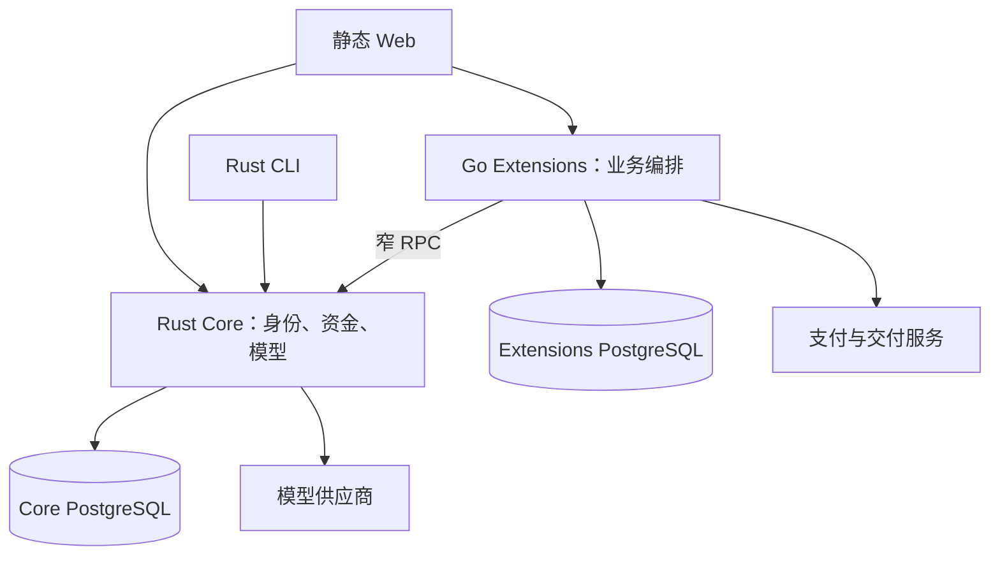

# LMM API 新旧站实测对比与生产上线路线图

**文档日期：2026-11-18（Asia/Taipei，UTC+8）**  
**用途：一次现场观察的证据基线、可执行的生产交付合同，以及持续工作的循环提示词。**  
**结论：新站已具备部分可用的界面和会话流程，但本次证据不足以支持它全量接管现有生产业务。应先关闭身份、资金、真实调用、迁移与恢复的验收缺口，再按资金主体受控切流。**

本报告把现场结果、固定版本源码解释和后续建议分开。它没有把未执行的支付、模型调用、迁移或故障演练写成成功，也不以页面数量或模型目录数量推算完成率。30 个任务是一套验收清单，不表示 30 项都尚未实现；已有实现应先核对版本和证据，避免重新开发已经完成的功能。

本次产出是实测报告、详细路线图和循环工作提示词；“能承载真实用户的高可用成品”是本路线图的最终交付门槛，当前站点尚未获得这项验收结论。

## 实测结论与最优先处理的问题

新版的变化不只在视觉上：现有浏览器会话能够恢复并续期，钱包采用 credits 和参考货币表达，状态页开始区分组件就绪与历史请求性能，商店的浏览、搜索和缺货状态也可操作。但付款闭环、真实外部模型调用、旧 Key 兼容、账务迁移、恢复和容量，都不能由这些页面结果代替验收。[E1]

最优先处理的事项如下：

| 顺序 | 需要解决的问题 | 为什么影响上线 | 对应任务 |
|---|---|---|---|
| 1 | 固定完整发布组合，并核对现场与主线差异 | 本次观察期间 Web build-id 从 04fef6f 变为 561faf51；不同构建的结果不能拼成一个候选版本的合格证据 | M0-01、M0-05、M5-01 |
| 2 | 关闭身份与旧资产迁移缺口 | 浏览器续期成功不代表旧 Key、MFA、授权服务器、余额和持续权益迁移完成；新站 OAuth 发现仍返回 503 | M0-03、M1 全组 |
| 3 | 形成真实调用及资金闭环 | 新钱包没有可用支付渠道；真实模型、充值、购买、提货、退款本次未执行 | M2-01、M3-02、M3-03 |
| 4 | 修正目录、价格、统计和能力声明的含义 | “—”“未知”、个人与全站统计、组件绿灯和固定 false 状态字段容易让人误判业务状态 | M1-03、M3-04、M3-05、M4-05 |
| 5 | 完成退役能力清理的发布闭环 | 现场和 561faf51 Web 源码仍有等级／开发者资格残留；基线主线中的修复并未全部进入所观察 Web | M0-02、M3-01、M5-01 |
| 6 | 验证资源、单写入、恢复与故障接管 | 没有这些结果，就不能对真实用户的资金安全、稳定性和可恢复性作出交付承诺 | M4 全组、M5-02 至 M5-05 |

上述排序依据现场 B01–B15、固定源码及既有生产合同；其中“需要验收”不等于“代码一定缺失”。[E1] [C1] [C2] [C3]

## 实测方法、环境和版本边界

### 测试入口与实际操作

测试使用 ssmcp 连接开发机，直接操作其浏览器。公共路径使用开发机 Chromium；已有账号路径使用用户原有 Chrome 会话。两个浏览器上下文分开记录，没有复制 Cookie、读取密钥或输出账户余额。新旧站为：

- 旧站：<https://api.lmm.best>
- 新站：<https://native.api.lmm.best>

已操作的路径包括首页、登录入口、已有会话恢复／续期、概览、钱包、模型价格、开发者页、工具市场入口、商店列表／搜索／缺货详情、新版手动 Key 页和新版状态页。HTTP 检查仅对公开、只读的已知端点执行 GET。证据以脱敏文字和结构化 JSON 保存。[E1]

同一开发机和网络减少了环境差异，但两版的配置、账号映射、数据快照和聚合口径没有被证明一致。本次不是性能对标，不据此给出“更快多少”“省内存多少”或迁移完成百分比。

### 版本变化是本次的重要发现

| 记录 | 时间（UTC+8） | 现场值／来源 | 解释 |
|---|---|---|---|
| 旧站公开状态 | 11-18 04:51:54 | version 0.2.118；x-new-api-version 0.2.118 | 公开接口版本声明 |
| 新站公开状态 | 11-18 04:51:55 | version 0.1.0；x-lmm-api-version 0.1.0 | 公开接口版本声明，不等于完整部署清单 |
| 初次新站 Web 元数据 | 11-18 04:52:56 | rv.04fef6f15b8214b56494ad2af8f3e2c8076035af.2k6e8r7p | 初次加载文档的 build-id |
| 末次新站 Web 元数据 | 11-18 05:13:27 | rv.561faf51a74a4000ebb2c7d812da4230eba3a213.2k6e8r7p | 重新导航后实际读取到的新 build-id |
| 末次只读复核 | 11-18 05:14:03 | OAuth 发现 503；公开价格 403；/health/ready 200 | 在后一次 Web 构建下重新核查的三个端点 |
| 代码分析基线 | 固定版本 | 源码 48f343fce385d77162868e3360947834382872f0；产品合同 595e281a28b05c5a0d2f1fc180f1f35eea440a15 | 用固定引用解释要求，不冒充最终生产制品 |

Web 构建发生变化是实测事实，变化原因没有推断。早期登录、钱包、价格等 UI 观察未逐项绑定末次构建，因此不能把所有截图视为同一候选版本的完整回归。Core、Extensions、CLI、schema 和实际配置的完整运行身份没有在本次得到核验。[E1]

### 本次没有执行的验收

新注册、全新密码／OAuth 登录、普通用户与团队越权检查、API key 新建／撤销、旧 Key 真实请求、外部付费模型调用、真实充值／退款、库存写入、数据库迁移、生产部署、容量压测、备份恢复和跨故障域演练均未执行。它们在路线图中保留为明确验收项。管理员已有会话的成功不能覆盖普通用户的访问行为。

## 新旧站实际差异

表内“通过”只指列出的具体路径；“未验收”表示缺少执行结果，不能自动解释为失败或尚未实现。全部浏览器和 HTTP 观察见脱敏证据 B01–B15。[E1]

| 路径 | 旧站实测 | 新站实测 | 结论和影响 |
|---|---|---|---|
| 首页与导航（B01） | LMM Forge，导航入口较多，主文案围绕模型接入 | LMM API，导航收敛，主文案围绕工具社区 | 新版更紧凑；工具市场／商店名称与入口需保持清晰。主题差异不用于评价默认设计优劣 |
| 访客访问价格／工具市场（B02） | 跳转登录并保留 redirect | 同样跳转登录并保留 redirect | 两版均有访问控制，不能把登录跳转记作页面损坏 |
| 登录与注册入口（B03） | 注册入口及更多 OAuth 选项可见 | 未显示注册；GitHub、Telegram 标为“仅限登录”；密码／Passkey 入口可见 | 仅比较可见入口，未验证所有登录供应商。首发是否仅面向旧用户应与产品文案一致 |
| 已有浏览器会话（B04） | 原会话可进入概览和钱包 | 先出现恢复提示，恢复后要求明确续期，续期成功进入控制台 | **已有会话恢复／续期通过**；全新登录、撤销和安全状态仍需独立验收 |
| 概览与统计（B09） | 既有账号历史统计可见 | 个人累计统计不可用，下方“所有账户”图表含导入历史 | 统计范围不同，不能凭可见数字断定账务丢失；需要按同主体、同单位、同时间口径对账 |
| 钱包（B07） | 余额、累计用量、请求数和人民币支付预览可见 | credits 及参考货币可见；累计用量／请求数不可用；显示暂无支付渠道 | 新版的真实充值与完整历史统计尚未由本次验收证明 |
| 等级与资格残留（B07、B15） | 历史设计仍可见 | 钱包仍有 L0／折扣；561faf51 源码仍含开发者资格判断 | 违反已退役范围的当前表达，应纳入发布清理；L0 可能只是缺字段默认值，不是实际身份或扣费依据 |
| 登录后的模型与价格（B08） | 页面显示 673 项，抽样可见 token 价格 | 页面显示 52 项，抽样输入／输出为“—”，路由“未知”；选择器抽样“暂无数据” | 这是不同会话下的目录快照；不能得出“只完成 7.7%”或“丢了 621 个模型” |
| 开发者页（B06） | 请求构建器有默认模型示例 | 目录暂不可用，可手工输入模型；构建器使用当前域名；OAuth 发现链接仍指向旧域 | 需要统一目录读取权限、示例和正式域／issuer 策略 |
| 文档示例价格 GET（B05） | /api/pricing 返回 404 Not Found | /core/v1/pricing/public 返回 403 pricing_forbidden，末次仍如此 | 旧示例与当前路径不一致；新响应属于应用访问策略，不能推断目录不存在 |
| OAuth 授权服务器发现（B12） | 返回 200，issuer 为旧域，声明 S256 | 返回 503 core_migration_incomplete，末次复核仍为 503 | **第三方授权服务器能力没有通过**；这与浏览器会话恢复是两条不同路径 |
| 商店列表与搜索（B10） | 3 个商品，均缺货；搜索 MetaStore 得到 1 项 | 同样 3 个缺货商品，搜索结果为同一项；卖家展示信息较简略 | 列表与搜索通过；卖家展示字段需要对齐，报告不保留个人资料 |
| 商店缺货详情（B11） | 详情可打开，库存 0，加入购物车禁用 | 同样表现 | 缺货状态通过；有货购买、库存、提货、退款均未验收 |
| 新版 Key 管理（B13） | 本次未核查旧 Key 列表 | /keys 可打开；Base URL 已含 /v1；手动 tab 空态 | 不能据此断言旧 Key 丢失；自动 tab、迁移、创建与撤销需另测 |
| 新版状态页（B14） | 未做同版本状态页对照 | 末次 API／数据库／模型路由绿灯；已有会话近 24 小时没有请求样本 | 组件健康展示可用；不等于真实供应商健康、正确计费或高可用达标 |

## 四个容易误判的地方

### 1. “已就绪”描述的是组件状态

末次 `/health/ready` 返回 200，同时明确给出：

```json
{
  "status": "ready",
  "database": true,
  "readiness_scope": "configured_components",
  "upstream_health_checked": false
}
```

561faf51 的状态页分别按 `status === ready`、`database`、`status === ready && capabilities.models` 显示三项状态。这个检查没有实际向每个供应商发起模型请求。历史性能数据是另一条查询路径；“绿灯”和“没有样本”可以同时成立。[E1] [C5]

公开 `/api/status` 还报告 `external_model_providers_enabled=false`、`payments_enabled=false` 和 `models_local_synthetic=true`。在所核对源码中，前两个字段是固定声明，第三个映射组件能力；它们不是对全部运行配置的实时审计。因此准确结论是“接口如此声明，真实调用和支付闭环未验收”，不能只凭这几个值判断全部外部线路绝对关闭。[E1] [C6]

上线前应让能力说明分别表达“配置存在”“组件可服务”“最近真实请求结果”和“对当前用户开放”。前端只展示对用户决策有帮助的状态；内部制品信息留在诊断界面和发布清单，不挤入充值、购买等用户流程。

### 2. 目录数量、价格占位和路由未知是三件不同的事

673 与 52 是页面可见目录数量，并非成功调用数量。不同分组、角色、权限和快照都可能影响目录。抽样的“—”可能涉及 billing_status、按次／动态价格、分组价格或字段转换；路由“未知”也可能只表示尚无运行探测。现有适配逻辑不足以支持“所有模型未实现”这种推断。[E1] [C10] [C11]

应选少量脱敏样本，连贯检查 `billing_status`、价格维度、`token_price`、分组规则、`rate_basis`、定价版本、路由版本和不可用原因，再追踪一次真实调用的报价、供应方回执、用量及最终账本。只有这条链路能说明用户看见的价格是否对应实际结算。

### 3. “浏览器能登录”和“第三方 OAuth 可用”分开验收

本次会话恢复使用已有浏览器状态，显式续期后进入控制台。这证明该恢复路径有效，但没有证明新账号注册、全新 OAuth 登录、第三方授权码与令牌流程、旧 MFA 或 Key 兼容。新站的授权服务器发现端点末次仍返回 503。若新站正式接管第三方客户端，这项必须闭合。[E1]

正式域、OAuth issuer、发现链接、授权／令牌／撤销端点、回调允许列表和 Passkey RP ID 需要一起核准；保留旧 canonical issuer 也可以是经过设计的选择，但不能让链接和实际服务处于未说明的混合状态。

### 4. 主线修复存在，不等于线上已经包含

代码基线 48f343f 已有平台等级／开发者资格退役修复；本次 Web 的 04fef6f 与末次 561faf51 仍保留相关 UI 和判断。561faf51 的钱包缺值默认 L0／0%，因此画面中的 L0 不能被用来推断实际用户等级或价格规则。[C3] [C7] [C8] [C9]

相同源提交内的 Core 定价代码含等级分支，并不证明运行 Core 正在启用该分支。正确处理方式是确认实际 Core 制品、配置与报价 `rate_basis`，选入适用修复后用同一发布组合验收，避免只换前端后沿用旧后端报告。

## 目标架构：让权威规则只有一个来源

Core 负责“谁有权限、可以花多少、这次算多少钱、模型请求怎样执行”；Go Extensions 负责商店、支付等扩展业务记录和编排，通过窄 RPC 请求 Core 做权威判断。二者使用独立数据库，扩展不取得 Core 数据库直连权限。静态 Web 和固定子模块的 Rust CLI 调用相同的业务合同。[C1] [C4]



这张图表达职责边界，不新增程序或部署 daemon。它也不要求每次用户操作都经过所有组件。扩展业务拥有订单状态；余额、预算、预留、扣费、退款和持续托管权利的财务结果由 Core 负责，两者通过稳定业务 ID、幂等键和可查询状态关联。

资金使用有界整数，`credit_500k_usd` 以 500000 单位对应 1 USD。历史单位由冻结来源及转换证明决定，不能按当前汇率或当前目录猜测。钱包、负债、佣金、预留、收入和持续权益分别保留，未知金额保留原始整数与原因，不能默认为零。[C1]

### 发布清单必须能回答的问题

一个候选版本至少记录以下内容：Core／Extensions／Web／CLI 的源码与制品摘要，schema／迁移校验值，脱敏配置摘要，入口与 issuer，provider 和支付开放范围，旧数据检查点、迁移批次、writer 归属，资源测试和恢复报告，以及可执行回退步骤。不得把密钥、数据库 DSN 或可复用凭证写入清单。

仓库进度已经记录过运行 Core 基座、主线 schema 组件数和 Web 候选之间的差异；这说明需要核对候选组成，并不授权直接把任意主线版本覆盖线上。本次仅将这些记录作为 M0 的调查依据。[C3] [C4]

### 建议先完成的三个工作批次

| 批次 | 具体工作 | 交付物与停止条件 |
|---|---|---|
| 第一批：冻结并重现 | 确认当前制品；重跑本报告的只读关键路径；对照退役修复与线上分支；核准 OAuth 域策略与能力字段语义 | 发布差异表、冻结范围、可重放检查；未知运行身份不能进入切流 |
| 第二批：一条完整真实用户链路 | 在隔离主体下打通旧账号／Key、文字和图片请求、人民币充值、计费、购买、库存、提货、退款和持续权益 | 真实入口回执与账本对账；缺授权的付费步骤明确阻塞，其他实现和沙箱验证继续 |
| 第三批：故障与发布 | 在同一候选上执行资源、故障、恢复和单写入演练；准备按主体灰度与回退 | G0–G4 及上线前条件通过后进入首批受控灰度，G5 用于观察与扩量；最终首发交付要求 G0–G5 全部通过，完整范围继续推进 |

时间安排以依赖和验收结果推进。发现既有有效证据时复用，改变相关行为后只补受影响的验证；不因追求“完成度高”而把全仓反复重测当成产出。

---


以下实施合同以固定产品需求和生产验收为基础；新增的高可用拓扑、SLO 与观察窗口单独标注为建议。[C1] [C2]

## 一、交付目标与执行顺序

新架构首先交付一个能让指定真实用户完成业务、资金结果正确、发生故障后可以恢复的版本。首发范围是旧账号与旧 API key 可继续使用，文字和图片 API 可调用，人民币充值与计费正确，商店购买、库存、提货、退款形成闭环，既有订阅和其他持续权益完整保留。首发的“完成”以真实入口的端到端结果、账本核对及发布证据为准。

公开全功能版本继续补齐全部保留能力，包括 Embeddings、Rerank、七种语言、全部保留支付 provider、MCP 助手及完整 CLI。Gemini 音频延后于首发，仍保留在后续交付范围。对首发后任务持续执行，直至通过公开全功能门槛；按批次推进，不用任意日期代替验收结果。

架构边界固定为 Rust Core、Go Extensions、静态 Web 和 Rust CLI。Core 是身份、资金、模型及价格规则的唯一权威；Go 扩展使用独立数据库，经窄 RPC 请求 Core 完成需要权威判断的操作；Web 负责交互和展示；Rust CLI 使用固定子模块。禁止为完成本路线图额外引入部署 daemon，也不通过复制 Core 业务规则到 Go、Web 或 CLI 来补功能。

开发者资格／付费激活、平台信任等级、LMM／Pi 内置远控和 FastPay 已退役。交付时清理其可操作入口、写入路径、权限判断与现行文案；历史订单、账务和审计资料按既定保留规则可追溯。历史兼容读取不得重新开启退役业务。新版钱包中仍出现的信任等级及其折扣表达，应作为范围一致性问题处理。

### 1.1 唯一进度入口

`docs/progress.md` 是动态进度的唯一来源。本路线图保留任务定义、依赖和验收标准，日常状态、负责人、commit、测试结果与阻塞只更新到 `docs/progress.md`，避免产生互相矛盾的第二份进度表。

每个任务使用稳定 ID，进度记录至少包含：`任务 ID、交付层级、状态、依赖、实现 commit、测试命令与结果、真实入口验证、独立验收结论、关联发布组合、阻塞及下一步`。状态建议为 `未开始 / 进行中 / 实现待验收 / 已验收 / 外部阻塞`。“已验收”必须同时拥有产出、目标验证与独立复核证据。

### 1.2 六个里程碑

| 里程碑 | 要解决的问题 | 可进入下一阶段的条件 |
|---|---|---|
| M0：冻结合同与证据基线 | 版本、范围、资产、测量口径尚未完全对齐 | 保留范围、迁移清单、同版本发布证据与验收脚本可复查 |
| M1：身份、资金与权益 | 核心权威和历史状态必须完整、正确 | 旧账号／Key、账本、价格、持续权益、迁移栅栏通过验收 |
| M2：API 与调用端 | 用户现有调用必须能在新架构中完成 | 首发文字／图片调用及路由异常语义通过；完整能力逐项推进 |
| M3：用户业务闭环 | 页面、支付、商店和订阅必须产生正确结果 | 首发用户任务在真实入口完成，退役入口清理完毕 |
| M4：资源、安全与可恢复性 | 版本必须在受限资源和常见故障下稳定工作 | 资源硬合同、账本不变量、安全隔离和恢复演练通过 |
| M5：发布、灰度与完整交付 | 通过可控切流把合格产物交给真实用户 | 首发门槛全部满足；继续完成公开全功能门槛 |

里程碑允许并行开展相互独立的实现和验证。涉及资金的切流必须等 M1、M4 和发布闸完成；首发不得被非首发功能的并行开发意外改变已验收版本。

## 二、30 项稳定任务清单

“首发”表示承接指定真实用户前必须通过；“完整”表示公开全功能交付前必须通过；“分层”表示条目中分别列出的首发和完整部分各自满足对应门槛。以下状态均由 `docs/progress.md` 维护。

### M0：冻结合同与证据基线

| ID | 层级与任务 | 必须产出 | 验收标准与依赖 |
|---|---|---|---|
| M0-01 | 首发：核准真实部署与代码基线 | 新旧入口、Core／Extensions／Web／CLI、schema、config 的版本映射；部署与仓库差异表；正式域名及 OAuth issuer 策略 | 每个站点明确请求实际流向、认证路径和配置来源；开发者页链接、发现文档、issuer 和授权端点与正式域策略一致；定位当前 Core 基座与主分支组件差异，逐项确定纳入或延期，禁止把另一版本测试结果归给待发布版本 |
| M0-02 | 首发：冻结保留范围和退役清单 | 首发／完整／延后范围表；退役入口清理清单；每项保留能力的用户任务 | 用户既有要求全部有去向；退役四类能力未被“对齐旧版”任务重新加入；Gemini 音频有稳定后续任务关联；范围变更留下明确依据 |
| M0-03 | 首发：历史资产与负债盘点 | 账号、Key、MFA、余额、订单、充值、价格、订阅、库存、退款、持续权益的数据映射与对账口径 | 每类历史对象都有来源、目标权威、迁移规则和核对方法；未知负债单独列出并逐项归零；持续权益完整列举并保留，不能通过抹除权益满足零未知负债 |
| M0-04 | 首发：建立可重放验收集 | 用户任务、API 合同、账本断言和资源负载的版本化脚本；脱敏样本与预期结果 | 一次运行可给出用例数、通过数、失败详情和账本结果；清楚区分合成上游、沙箱支付和真实服务；浏览器路径、响应状态及最终业务结果可复查；负载合同按本文件第四节执行，并固定正常阶段、过载和恢复窗口的统计边界 |
| M0-05 | 首发：统一发布身份与证据格式 | 同一发布组合的清单、预检入口、产物及证据索引规范 | Core／Extensions／Web／CLI／schema／config 的版本共同固定；证据能追溯到相同组合；禁止只升级前端后沿用旧后端报告；复用现有发布机制，不新增部署 daemon |

### M1：身份、资金与持续权益

| ID | 层级与任务 | 必须产出 | 验收标准与依赖 |
|---|---|---|---|
| M1-01 | 首发：迁移账号、旧 Key 与认证状态 | Core 身份迁移、旧 Key 兼容、会话续期、退出／撤销、历史 MFA 处理及保留的 OAuth 授权服务器能力 | 老用户的账号、Key 归属、权限和安全状态保持正确；正常会话恢复、过期续期、撤销、禁用及错误凭证均有实际验证；浏览器会话与第三方 OAuth 分别验收，发现文档、issuer、PKCE 及保留的授权／令牌流程独立通过；先完成 M0-03，历史 MFA 的未闭合项归零 |
| M1-02 | 首发：完成账本与预算不变量 | 预留、扣费、释放、退款、充值、幂等与预算的一套 Core 实现；固定精度金额合同 | 每个业务事件可关联到唯一财务结果；重试和重复回调不重复记账；并发调用不绕过预算；失败／取消／超时后的余额、预留和结算最终一致；不得用前端金额替代 Core 计算 |
| M1-03 | 首发：统一模型、组价与计费规则 | 历史模型及组价映射、版本化价格规则、计量明细与结算样本 | 固定进度基线记录的 95 个模型／组价原始保留项逐项形成迁移结果（不是 95 个已证实不可用模型）；文字、图片及首发已承诺的 cache／reasoning／搜索／抓取等维度计算正确；报价、供应方回执、用量与 Core ledger 能对应；未知价格和不支持项明确拒绝，禁止默认为免费 |
| M1-04 | 首发：保留订阅与持续权益 | 既有订阅、剩余期限、额度、续费和取消规则的迁移与到期处理 | 每份已知持续权益有前后对照和未来结算规则；迁移、切流、回退均不丢权益；重复续费回调及到期并发不重复增减权益；与商店订阅、钱包展示一致 |
| M1-05 | 首发：落实单写入方与切流栅栏 | writer 管理、归属判定、写入停止与恢复流程、迁移校验与回退条件 | 切流检查显示 `active writers=0` 且 `unknown liabilities=0`；随后仅启用目标权威写入方；旧 worker、回调、请求和退款须 drain 并真实读回；旧写入方不可因重试或故障恢复重新写入；死亡 holder 接管需死亡证明及一次 CAS；已知持续权益随主体迁移保留；依赖 M1-01 至 M1-04 |

### M2：模型 API、助手与 CLI

| ID | 层级与任务 | 必须产出 | 验收标准与依赖 |
|---|---|---|---|
| M2-01 | 首发：打通文字与图片 API | 首发文字、图片请求及响应合同，JSON／SSE、错误码、超时、取消的完整处理 | 旧 Key 经真实外部入口调用已启用 provider 成功；合成模型单独标识，不计作真实 provider 接通；SSE 完整读取至终止，内容、结束状态、用量和账本都核对；真实调用采用已授权的隔离测试额度 |
| M2-02 | 首发：渠道控制、限流与故障语义 | 渠道启停、模型绑定、多 Key、排序、组／用户／Key 限制及 fallback 的统一执行 | 业务配置在实际路由生效；禁用渠道和 Key 不再获流量；失败前后记录清晰；已产生外部付费请求或已输出响应时按明确语义处理，不盲目重试；容量耗尽可控拒绝并保留正确财务状态 |
| M2-03 | 完整：完成 Embeddings、Rerank 与后续模态 | Embeddings／Rerank 接口、模型映射、计费与兼容样本；Gemini 音频后续接入清单 | 每项以请求语义、响应结构、批量边界、错误处理、用量计费和真实 provider 样本验收；Gemini 音频继续推进但不阻塞首发；不得仅增加菜单或 endpoint 即记完成 |
| M2-04 | 完整：完成保留的 MCP 助手能力 | 助手、工具及 MCP 的边界合同、会话状态、取消／恢复、权限和用量归属 | 所有保留用户流程可完成；工具调用权限及计费归属通过；长会话、失败、取消、恢复有结果；运行逻辑服从 Core 权威；不重新加入 LMM／Pi 内置远控 |
| M2-05 | 分层：固定 Rust CLI 并完成能力对齐 | 固定子模块版本、安装／更新／登录／调用／诊断及全部保留命令的矩阵 | 首发所需诊断和调用命令可用于验收、运维；完整交付时全部保留 CLI 命令通过实际执行；CLI 与同一发布组合匹配；权限及价格规则来自 Core；不增加部署 daemon |

### M3：支付、商店、订阅与用户界面

| ID | 层级与任务 | 必须产出 | 验收标准与依赖 |
|---|---|---|---|
| M3-01 | 分层：完成账号界面、语言和退役清理 | 登录／恢复／账户与 Key 管理界面，七语言清单，退役界面及路由清理 | 首发任务在桌面与移动端可完成，会话续期行为清晰；平台信任等级及其派生准入／折扣、其他退役现行入口清零；合法分组价与其他保留计费规则继续生效；首发若只开放旧账号，注册关闭必须与开放范围一致；公开全功能交付验证所有保留注册流程和七种语言，关键路径无未翻译键值 |
| M3-02 | 分层：完成充值与支付 provider | 人民币充值报价、订单、回调验证、入账、异常处理；全部保留 provider 的迁移表 | 首发至少有明确可用的人民币支付路径并完成真实入口闭环；前端展示、实收金额、Core 入账一致；验证重复、乱序、伪造和延迟回调；将指向旧版的 webhook 按切流计划迁移；完整交付逐一验收全部保留 provider，FastPay 仅保留历史 |
| M3-03 | 首发：商店购买、库存、提货与退款 | 商品／价格、库存预留、支付确认、交付、取消和退款状态机；Core 与扩展的窄 RPC；经授权的隔离测试商品与库存 | 购买可完成，库存不超卖，交付不重复；退款状态、库存回补、资金回退一致；支付成功但交付失败等恢复路径可重放；缺货浏览与有货交易分别覆盖；卖家公开展示字段和数据源对齐，报告仅描述字段完整性；扩展独立库不复制资金权威；每笔交易具备业务与账本关联 |
| M3-04 | 首发：修复模型目录、价格和选择器 | Core 驱动的模型目录、价格细节、分组价展示及 quick picker，明确不可用状态 | 目录数量、可调用集合、用户可见报价和选择器来自同一数据合同；已配置价格不再显示含义不明的“—”；空目录说明原因且能恢复；不得把缺价显示为 0；实际调用结果与展示支持范围一致；按保留范围逐项核对，目录数量差异不用于推算开发完成率 |
| M3-05 | 首发：完成钱包、订阅和用量闭环 | 余额、充值记录、历史费用、API 计数、用量明细、订阅持续权益及必要运营页面 | 首发用户能查到与账本一致的金额和用量；历史缺项有迁移结果；空、加载、无权限和失败状态明确；列表筛选分页、时间和金额格式正确；关键流程截图自检并通过独立交互验收 |

### M4：资源合同、安全与可恢复性

| ID | 层级与任务 | 必须产出 | 验收标准与依赖 |
|---|---|---|---|
| M4-01 | 首发：达到固定资源与负载合同 | 单 Core、Core＋Go、1C1G 整机三组独立资源报告，版本化负载脚本和原始指标 | 单 Core 1 CPU／256 MiB；Core＋Go 共用 1 CPU／512 MiB；1C1G 整机另验。以 5 RPS、80% JSON／20% SSE 执行规定时序，正常阶段完整成功率≥99%、P95≤1s、P99≤2s，并同时通过账本断言；过载单独验收有界拒绝、资金正确和恢复；不得用 TTFB 代替完整完成时间 |
| M4-02 | 首发：验证失败、取消、重试与恢复 | 支付／上游／库存／队列等支持场景的故障用例和最终一致性检查 | 每个可达失败场景都说明谁拥有重试权、何时可重试、幂等键与补偿状态；断流、进程中断、重复消息后不重复收费或交付；未决操作能查清和收敛；不以无限重试掩盖错误 |
| M4-03 | 首发：完成权限、隔离与供应链检查 | 用户／团队／管理员访问矩阵、Key 范围、敏感数据处理、必要依赖和产物检查 | 跨用户、跨团队、普通用户访问管理接口等用例全部符合合同；凭证和支付敏感信息不进入公开日志／报告；撤销权限及时生效；所测构建产物与发布清单一致；只验证支持范围内的实际攻击面 |
| M4-04 | 首发：交付可恢复部署；完整：落实建议的高可用拓扑 | 已演练的备份／恢复／故障处理方案；跨故障域高可用建议与采用记录 | 首发必须有恢复演练、单写入保护和可执行 runbook。若对外声明高可用，进一步验收跨故障域部署、切换栅栏、依赖故障和恢复目标；单机资源测试与高可用证明分别记录；新增拓扑和目标按第五节建议确认并落实 |
| M4-05 | 首发：建立可操作的监测与诊断 | 请求关联、延迟、错误、负载、SSE、支付、账本、预留、库存、writer 的指标与告警；值守 runbook | 能从一次用户失败定位对应请求、渠道、业务状态与财务结果；告警实际触发且可恢复；达到停止扩量条件时能停止并诊断；不将凭证、用户内容或完整支付材料上传公开交付位置 |

### M5：发布、灰度与最终交付

| ID | 层级与任务 | 必须产出 | 验收标准与依赖 |
|---|---|---|---|
| M5-01 | 首发：形成可发布的不可混用版本组合 | 通过预检的发布清单、构建产物、同版本测试与独立验收记录 | 必需 CI 和对应实测通过；Core／Extensions／Web／CLI／schema／config 固定为同一组合；资源报告、迁移演练与用户任务结果都适用于该组合；阻塞首发的问题归零 |
| M5-02 | 首发：完整演练迁移与回退 | 非生产或隔离环境中的迁移、停止旧写入、对账、目标启写、回退演练和操作顺序 | 所有必需数据及权益核对通过；满足 `active writers=0`、`unknown liabilities=0` 后才进入切流；回退处理新增交易和 schema 兼容，禁止简单切旧库；完成备份恢复并记录实际耗时 |
| M5-03 | 首发：按账户或资金主体灰度 | 账户／团队／资金主体归属规则、灰度名册、流量与写入边界、回退控制 | 一笔交易涉及的买方、卖方、佣金、托管和其他账务对手方必须处于同一资金权威；先统一资金权威，或迁移能闭合交易的主体集合；跨边界交易在实现并验收前不得放行；禁止逐请求随机分流到两套独立账本；可对脱敏只读结果 shadow 比较，不重复发送外部付费请求；先指定测试主体，再分批扩大；每批满足全部扩量条件 |
| M5-04 | 首发：稳定观察并交付真实用户版本 | 按合同窗口的运行记录、财务核对、故障处理、用户任务回归和版本交接 | 灰度期间无未解释的余额／权益／库存差异，无未关闭的首发阻塞；完整成功、延迟及资源目标持续满足已声明窗口；实际入口可用；恢复步骤、联系人和交接材料齐备；达到第七节首发门槛 |
| M5-05 | 完整：补齐并验收公开全功能版本 | 全部保留能力的完整矩阵、七语言、全部保留支付 provider、MCP 助手、CLI 和后续模态结果 | 路线图完整范围逐项验收，Gemini 音频按后续范围关闭；所有公开入口可用；高可用方案已明确采用，并完成独立故障域与恢复目标实证；公开文档与支持矩阵一致；达到第七节公开全功能门槛 |

## 三、不可跨越的验收闸

### G0：范围和版本闸

发布候选必须携带确定的 Core、Extensions、Web、CLI、schema 和 config 身份。实现、测试、独立验收和部署检查均引用该组合；任一会改变相关行为的组件或配置变更后，重跑受影响检查，保留仍适用的通过证据。当前浏览器看到的界面和另一个分支的测试结果分别记录。

已退役能力不计入待补齐分母。公开界面、业务路由、写入口和现行文案必须与范围合同一致，历史存档以只读形式保留必要追溯能力。合成模型、沙箱支付和关闭的生产开关均在支持矩阵中明确标识。

### G1：身份、资金和权益闸

旧账号与 API key 可用，历史安全状态有明确迁移结果；每条首发业务路径的金额、预留、扣费、退款、库存、交付和持续权益满足对应不变量。报价、供应方回执、用量记录和账本结果可以关联复查。所有已知持续权益完整保留，所有未知负债项完成调查和处置。

财务一致性失败即阻塞发布和扩量。任何性能优化、兼容处理、临时开关或 fallback 都不能跳过 Core 的权威判断，也不能通过忽略失败样本提高通过率。

### G2：首发用户任务闸

至少逐一完成：旧账号登录与恢复、旧 Key 调用、文字 API、图片 API、人民币充值、查询正确余额与用量、商店购买、库存扣减、提货、退款及持续订阅权益。每项同时核对 UI、接口和最终业务结果。保留的第三方 OAuth 授权单独验证发现文档、issuer、端点、PKCE 和令牌流程；浏览器登录结果与 OAuth 结果分别记录。商店缺货时的正常禁用状态可以单独通过，有货交易仍需授权的隔离商品和库存完成验收。真实 provider 和真实支付端到端测试按已有具体授权执行；未具备相应授权或条件的项目明确处于外部阻塞，其他独立工作继续。

### G3：资源和负载闸

三种资源口径分别通过，固定负载合同全部满足，账本断言与负载同一次运行验收。单一“所有单元测试通过”或某一进程低 RSS 不能替代这组结果；报告直接列出资源限额、测量口径、成功率、分位延迟和财务不变量的结果。

### G4：发布与切流闸

切流前完成备份与恢复演练、迁移演练、数据核对、回退准备；现场确认 `active writers=0` 且 `unknown liabilities=0`，然后仅启用目标权威写入方。涉及旧版支付 webhook、异步订单和在途操作时，先完成明确的归属与收敛，不让切流后的旧回调重新取得资金写入权。

### G5：上线后扩量闸

每一批灰度必须保持用户任务可用、资金和权益无未解释差异、资源及延迟满足约定、无持续增长的未决事务，监测和恢复控制可用。出现财务不变量破坏、写入方冲突、严重权限问题、无法收敛的业务状态或资源失控，立即停止扩量，按故障级别执行受控止损和恢复。

## 四、固定资源和负载验收合同

### 4.1 资源口径

| 组别 | 硬性配置 | 必须记录 |
|---|---|---|
| A：单 Core | 1 CPU、256 MiB | Core 限额和实际总内存、峰值、OOM／重启、CPU、队列与连接池状态 |
| B：Core＋Go | 二者共用 1 CPU、512 MiB | 共享限额下的总用量与各进程辅助指标；不得给每个进程分别 1 CPU／512 MiB |
| C：完整部署 | 1C1G 整机另验 | 全机内存、系统和服务开销、部署拓扑及所有进程；明确外置依赖，不隐去整机负担 |

A、B 组的 PostgreSQL、负载生成器及合成上游在产品进程预算外单独列账；C 组按真实整机拓扑核算。使用操作系统或容器的实际限制执行测试，并记录总内存限制及 OOM 事件。RSS／PSS 可用于解释各组件开销，最终判定遵守对应组别的总资源合同。后续引入高可用拓扑时，每节点资源和整体资源另列，避免把单节点达标推广为全系统资源结论。

### 4.2 负载与时序

| 阶段 | 时长 | 目的与判定 |
|---|---|---|
| 预热 | 60 秒 | 建立连接与缓存，记录状态，不把预热隐藏为启动成功 |
| 稳态 | 300 秒 | 5 RPS；80% JSON、20% SSE；完整成功率和分位延迟按合同统计 |
| 过载 | 60 秒 | 按仓库既定过载强度执行；记录限流、队列、内存和资金结果，禁止临时降低强度 |
| 恢复 | 60 秒 | 回到约定负载，确认错误率、延迟、连接和未决操作恢复 |
| 排空 | 60 秒 | 停止新增负载并完成在途请求，核对预留释放、结算和最终账本 |

测试脚本必须固定请求组成、模型／上游行为、请求大小、超时、连接方式、过载强度、统计窗口与排空规则。若现有合同对某参数没有定义，应在 M0-04 形成明确测试参数并记录依据，不为取得漂亮结果临时改变参数。

正常阶段的完整成功率必须达到 99%，P95 不高于 1 秒，P99 不高于 2 秒。过载阶段单独评估有界拒绝、资金正确和恢复能力，不能偷偷混入正常窗口，也不能用全部 503 伪装达标。JSON 的成功需要完成并校验响应；SSE 的成功需要完整读取至协议终止并验证内容、终止状态、用量和结算。首字节延迟可以作为补充指标，不能替换完整完成延迟。各阶段结果分别展示，合同要求的总计或窗口口径保持一致；测试框架丢失请求、超时或读取不完整都进入对应失败统计。

同一运行必须同时通过账本断言，包括余额与预留关系、幂等、无重复扣费、无未解释负数、失败后释放和排空后事务收敛。资源达标而账本不变量失败的候选版本仍判为失败。

资源测试使用什么上游必须明示。合成上游适合隔离网关开销；真实 provider 端到端结果用于验证对外合同。两类证据分别记录，合成模型测试不能自动关闭真实 API 接入任务。

## 五、高可用实施建议：在恢复能力上增加独立故障域

以下内容是建议新增的高可用设计，需要结合现有服务器和依赖条件选择实施方案。已经写入现有合同的单写入、财务一致性、备份恢复和受控回退仍是首发硬条件。最终高可用成品必须有明确采用的方案和对应故障演练证据；具体拓扑可以按现场条件调整，高可用交付目标保持不变。

单机资源验收说明一个部署在限额内可以工作。面向真实用户声明高可用，还需处理整机、网络和依赖故障，避免所有实例处于同一个故障域。建议优先复用现有入口、服务管理和监测系统，新增必要的冗余与恢复能力，保持部署结构简单。

| 建议项 | 最小实施方向 | 必须通过的验证 |
|---|---|---|
| 独立故障域 | 将可服务实例或可靠备用放在独立主机／故障域；明确入口及数据库是否仍为单点 | 一个故障域退出后，剩余路径按合同继续服务或在已声明恢复时间内恢复 |
| 单写入与隔离 | 先核对并补齐 writer／epoch 与持久化栅栏合同；接管前证明旧写入方失效；死亡 holder 以死亡证明及一次 CAS 接管 | 旧实例恢复、网络分区、租约变化时均不会形成双写；不能只凭进程存活状态决定接管 |
| 数据备份与恢复 | 自动备份、可验证恢复、按数据种类明确恢复点目标 | 在隔离环境恢复账号、账本、订单、库存和权益，并完成业务与金额核对 |
| 入口与依赖故障 | 明确健康检查、超时、限流、隔离、降级和人工接管方式 | 数据库、上游、缓存或支付回调异常时，系统可诊断且保持正确资金状态 |
| 自动恢复边界 | 仅对具备安全重试语义的操作自动重试；外部支付／模型调用具备幂等或明确状态查询 | 故障注入后没有重复付费调用、扣费、退款或交付；不确定结果进入可审计恢复流程 |
| 可用性目标 | 定义用户任务成功口径、统计窗口、恢复时间和恢复点目标，再以实测和持续观测验证 | 监测报告使用真实统计窗口；不能把短时 smoke 结果写成长期 SLA 已实现 |

高可用验收至少包含服务进程退出、单节点不可用、旧 writer 恢复、数据库连接中断、上游长时间失败和支付回调延迟等支持场景。故障注入在具备授权的隔离环境或约定演练窗口实施，不中断其他开发任务，也不借实测对比任务直接执行生产破坏性演练。

### 5.1 建议采用的量化目标

以下是为“高可用成品”提出的新目标，不是已达到的指标，也不替换仓库现有验收合同。在 M0 冻结可用性定义，在 M4-04 演练，在 M5 持续观察；若基础设施不支持，应说明差距并选择可实现的配置，不能直接删去高可用目标。

| 指标 | 建议目标 | 口径及实施要求 |
|---|---|---|
| 核心用户任务可用性 SLO | 30 天窗口 ≥99.9% | 按合同范围内有效请求／用户任务尝试统计完整结果；入口不可达、5xx、容量拒绝、超时及不完整响应计失败；恶意／无效凭证、合同外流量、用户取消等排除规则预先冻结并单列；外部探针覆盖入口全失联，另报按时间可用性；上游影响不从用户端到端报表隐藏 |
| 故障恢复时间 RTO | 单服务／节点故障后 ≤10 分钟 | 从故障发生到核心用户任务恢复，实际演练计时；允许安全降级，不能通过错误放行资金请求维持“可用” |
| 已确认资金事件恢复点 RPO | 0 | 对外确认前获得足够持久化保证；数据库复制／仲裁、幂等回执和恢复重放共同验证，不能把异步备份当作零丢失证明 |
| 可重建非资金数据 RPO | ≤5 分钟 | 明确目录缓存、统计与索引等可重建数据范围；账户安全状态、订单与持续权益不自动归为可丢失数据 |
| 灰度观察窗口 | 建议先 24 小时指定主体，再 72 小时小范围 | 每批规模由已验收容量决定；资金不变量和权限问题零容忍；这些窗口不证明 30 天 SLO 已实现 |

一个月内可用性比例不是靠短时压测得到的。首发可以交付已演练的恢复能力和小范围运行结果；公开高可用声明必须对应已采用拓扑、故障证据与真实观察窗口。

### 5.2 建议的最小高可用拓扑

静态 Web 使用现有 CDN／缓存发布并保留可回退资源；入口具备健康检查和稳定超时。Core 与 Extensions 的可服务实例或备用位于至少两个独立故障域，每个应用节点资源单列，不能把两节点的总资源说成仍是一台 1C1G。Core 与 Extensions 仍保持逻辑数据库、账号和访问权限隔离。

数据库采用能证明持久化和接管语义的托管或自建高可用配置；选主／仲裁必须能区分故障与网络分区，禁止只靠两个节点互相 ping 后各自接管。备份独立保存，恢复到隔离环境后核对账号、Key、MFA、安全权限、账本、订单、订阅、持续权益、序列和 ACL，再启动业务复核。

多个 Core 服务进程不等于允许多个互不一致的资金权威。所有实例必须服从同一权威数据库、事务和幂等规则；新旧架构切换时，旧写入方仍须被栅栏隔离。最终证据需同时覆盖进程故障、整机故障、数据库故障及旧实例恢复，不能只用 kill/restart 一个进程代替高可用验收。

## 六、按账户和资金主体灰度上线

灰度首先解决“这笔资金和业务由谁负责”。一个账户、团队或共享资金主体及其关联 Key、订单、订阅和退款，应有一致的权威归属。禁止把同一主体的请求随机逐次分配给两套独立账本。

商店交易还会跨越买方、卖方、佣金账户和托管资金，仅保持买方账号归属一致仍不够。灰度集合必须覆盖一笔交易的全部账务对手方和持续权益。优先先统一资金权威再做入口灰度，或迁移能闭合交易的主体集合；若交易图把大量主体连接在一起，应采用更大的统一迁移边界。买方在新账本、卖方仍在旧账本的跨边界交易，在专门实现并验收之前不得放行，不能靠异步补记掩盖两套资金权威。

推荐顺序如下：

1. **固定发布组合。** 完成预检和必需验收，封存对应的版本、配置、迁移计划和证据。
2. **使用隔离主体演练。** 先验证身份、调用、充值、购买、提货、退款、订阅和故障恢复，不改真实用户的归属。
3. **准备指定灰度主体。** 核对其资产、权益、在途订单、异步回调和回退要求，明确目标写入方。
4. **停止并收敛旧写入。** 对约定迁移范围执行停止写入和收敛流程，确认 `active writers=0` 与 `unknown liabilities=0`；保持已知持续权益完整。
5. **启用目标权威并验证。** 由新 Core 接管该主体，现场完成用户任务和财务核对，验证旧回调和旧实例无法再次写入。
6. **观察后扩展下一批。** 每批通过扩量闸再迁移下一组主体；明确每批规模和观察窗口，规模依据实测和运维能力确定。

按主体灰度的前提是归属路由、写入栅栏和异步回调能够对同一主体一致生效。若现有实现只具备全局栅栏，应先采用全局停止写入的受控切换，或补齐并验收主体级能力；不能仅在反向代理上加随机权重就宣称支持资金灰度。

只读 shadow 可比较可脱敏的目录、报价或查询结果；对于外部付费模型请求、真实支付、库存扣减和交付，禁止为了比较同时发起两份有副作用的请求。需要复现时使用固定回执、沙箱 provider 或已授权的隔离样本。

回退首先检查新架构已经产生了哪些新增交易和权益变化。根据预先演练的数据兼容与反向迁移流程恢复服务，保持单一权威和账本连续性。仅修改入口让用户回到陈旧数据库的操作不属于合格回退。

## 七、两级最终交付门槛

### 7.1 可承担真实用户的首发版本

同时满足以下条件，才将版本记为“可承担指定真实用户”：

- 所有首发任务和 G0–G5 对应门槛通过，首发阻塞归零。
- 旧账号、旧 Key、文字／图片 API、人民币充值、正确计费、商店购买／库存／提货／退款和持续订阅权益在真实入口完成。
- 所用真实 provider、人民币支付路径和生产开关均与公布范围一致；合成模式不冒充真实服务。
- 单 Core、Core＋Go 和 1C1G 整机资源分别验收；固定负载合同与同次账本断言通过。
- 迁移前后账务及权益核对通过，`active writers=0`、`unknown liabilities=0` 的切流条件有现场证据，目标写入方保持唯一。
- 备份恢复、回退、监测和异常收敛已演练，支持团队可按 runbook 操作。
- 同一 Core／Extensions／Web／CLI／schema／config 发布组合拥有独立验收结论，且灰度观察满足预先记录的窗口和扩量标准。

首发可以按已经明确的范围仅开放指定旧用户；关闭新注册必须与用户可见的开放范围一致。若要同时宣布高可用，还需完成所采用高可用拓扑的跨故障域与恢复目标验证。

### 7.2 公开全功能版本

公开全功能交付在首发门槛基础上继续满足：

- 全部保留能力有完整实现与端到端证据，Embeddings、Rerank、七种语言、全部保留支付 provider、MCP 助手和完整 Rust CLI 逐项通过。
- Gemini 音频等延后项按后续交付合同完成，公开支持矩阵与实际能力一致；若仍延期，应将版本命名为范围受限的公开版本，并列出尚未完成的任务。
- 所有公开入口、注册与账户流程、用户文档、SDK／CLI 示例、错误说明和价格展示与实际行为一致。
- 已退役的开发者资格／付费激活、平台信任等级、LMM／Pi 内置远控和 FastPay 没有恢复现行业务入口；必要历史数据可追溯。
- 高可用方案已明确采用，完成独立故障域、单写入、备份恢复、监测与恢复目标验证，并积累符合约定窗口的运行数据；缺少服务器或依赖条件的项目记录为明确外部阻塞，完成其他独立交付工作后继续关闭。
- `docs/progress.md` 中完整范围全部达到已验收；每项完成度都能下钻到 commit、测试、真实入口结果及发布版本，不以页面数量或代码规模计算虚假的百分比。

## 八、可直接复制的循环工作提示词

```text
你负责持续交付 LMM API 新架构，目标是完成首发门槛，再完成公开全功能和高可用门槛。实际编写代码、验证、修复并持续推进，直至能够承接真实用户。

实现仓库：TokenNotIncluded/lmm-api-source。
路线图：docs/reports/lmm-production-roadmap-2026-11-18.md。
动态进度：docs/progress.md。
开发机路径以现场为准，已知实现路径为 /home/lightjunction/Documents/GITHUB/lmm-api/generated/lmm-api-source。

一、工作入口与依据
1. 优先使用已授权的 ssmcp 开发机，定位实际 LMM API 仓库和当前运行站点。先检查 Git 状态、分支、已有修改、工作树和正在运行的任务，保护用户修改，不中断其他构建，不擅自清理未追踪文件。
2. 阅读仓库 AGENTS.md、发布合同、本路线图，以及动态进度唯一入口 docs/progress.md。核对当前 Core、Extensions、Web、CLI、schema、config 的实际版本。历史对话和旧报告仅作线索，现场证据决定当前状态。
3. 优先用 GitHub 插件进行仓库协作，小批次提交并推送，不把全部提交拖到最后。交付报告同时尝试同步 Google 云盘，记录真实位置；对公开提交和报告做必要脱敏。
4. 禁止派生 ssmcp 内部子 agent，也不借开发机调用外部模型。可以由本会话直接派生独立审阅 agent，用于代码审查和验收；并行工作明确文件和职责边界。

二、固定架构和范围
5. Rust Core 是身份、资金、模型和价格规则的唯一权威；Go 扩展独立数据库、窄 RPC；Web 静态；Rust CLI 使用固定子模块。复用现有实现和发布机制，禁止新增部署 daemon，禁止把 Core 规则复制到 Go、Web 或 CLI。
6. 开发者资格／付费激活、平台信任等级、LMM／Pi 内置远控和 FastPay 已退役，不得补回现行业务。必要历史订单、账务和审计数据保留可追溯性。
7. 首发必须完成：旧账号和旧 Key、文字／图片 API、人民币充值与正确计费、商店购买／库存／提货／退款、订阅持续权益。继续完成 Embeddings／Rerank、七种语言、全部保留支付 provider、MCP 助手、完整 CLI；Gemini 音频延后首发但保留后续任务。

三、每轮执行闭环
8. 先把路线图的稳定任务 ID 映射到 docs/progress.md 的既有进度，缺失条目补登记，不覆盖已有结果；用适用版本的证据承接已经完成的工作。选取依赖满足的最高优先级任务，优先关闭阻塞首发的问题。对可独立完成的工作并行推进，外部阻塞只阻塞其依赖项。
9. 先明确该任务的产出、验收条件和会失败的具体场景，然后实际编写代码、迁移、必要测试与文档。保持界面简约、留白充分、克制一致，关键页面截图自检。清理重复实现，保留可读性和正确性。
10. 自测覆盖本轮改变的合同和真实用户路径。浏览器会话与第三方 OAuth 授权分别验收；核对正式域名、issuer、发现文档和开发者页链接。商店缺货浏览与有货购买分别覆盖。失败立即定位并修复，继续验证。代码和运行条件未变时复用有效通过结果，不进行无目的的全量重复测试。
11. 实现自测通过后交给独立审阅 agent 或独立验收步骤核查，重点检查账本、权限、失败恢复、协议与用户任务。审阅依据是实际变更和运行证据，发现问题继续修复，直到本轮验收闭合。
12. 完成本轮后小批次提交并推送；在 docs/progress.md 更新任务 ID、实现 commit、验证结果、真实入口、独立验收结论、相关发布组合和下一步。路线图正文只维护合同，不另建第二份动态进度。
13. 继续下一项。不要在仅有规划、示例代码、TODO、只读页面或合成模型通过时将保留功能标为完成。遇到确切外部阻塞，完成所有独立工作后说明阻塞、已完成部分和最小所需条件。

四、不得降低的验收合同
14. 单 Core 必须在 1 CPU／256 MiB 下验收；Core＋Go 必须在共用 1 CPU／512 MiB 下验收；1C1G 整机另验，分别记录实际资源限额、总用量和进程开销。
15. 使用 5 RPS、80% JSON／20% SSE；60 秒预热、300 秒稳态、60 秒过载、60 秒恢复、60 秒排空。保持仓库规定的过载强度和统计口径，正常阶段完整成功率≥99%、P95≤1 秒、P99≤2 秒；SSE 必须完整终止，不能用 TTFB 替代；账本断言与同次负载一起验收。
16. 关键财务操作必须幂等且可追溯。取消、超时、断流、重复回调、重试和 fallback 不得造成重复付费请求、扣费、退款或交付。不确定外部结果进入明确的查询或恢复流程，禁止盲重试。
17. 所有验收证据绑定同一 Core／Extensions／Web／CLI／schema／config 组合。相关组件或配置改变后重验受影响部分，不能混用不同版本的通过报告。

五、部署与切流
18. 以本提示词作为继续实现与验收的工作指令，直接完成路线图范围内的代码、迁移脚本、必要测试、修复、文档和小批次提交推送。区分实现、验收与部署；生产切流、真实资金操作、外部付费模型调用按会话已有具体授权执行。已有明确授权的动作直接推进，不重复询问。缺少必要授权或外部条件时，先完成所有独立准备，展示可审阅结果、确切阻塞和最小所需条件。
19. 准备部署时先完成备份恢复、迁移、回退与发布预检。在切流点确认 active writers=0、unknown liabilities=0，同时保留全部已知持续权益，再仅启用目标权威写入方。
20. G0–G4 和上线前条件通过后进入首批灰度，G5 用于观察与扩量。按账户／团队／资金主体灰度，保持 Key、订单、订阅、退款及买方／卖方／佣金／托管等全部账务对手方的权威归属一致。先统一资金权威或按闭合交易集合迁移；未验收的跨账本交易不得放行，禁止逐请求随机分流到两套独立账本。只读 shadow 可以用于比较，禁止重复发送外部付费请求、真实支付或交付操作。
21. 每批灰度通过用户任务、资金核对、资源、延迟、监测和异常收敛标准后再扩量。发生账本不变量破坏、双写、严重权限问题或无法收敛的业务状态时停止扩量并按已演练流程恢复。回退必须处理新版本已产生的交易，不能只切回旧库。
22. 高可用新增拓扑按路线图的建议和已接受方案实施。单机资源与跨故障域验证分别报告；不凭短时测试宣称长期 SLA 已实现。

六、结束条件与交付
23. 首发所有任务及验收闸通过后，交付可承担指定真实用户的版本、真实地址、固定发布组合、测试与独立验收证据、运行手册和恢复结果；继续推进完整范围。
24. 公开全功能交付要求全部保留功能、七语言、全部保留支付 provider、MCP 助手、CLI 及后续模态按合同验收，公开支持矩阵与实际一致，已采用高可用方案经过实证。
25. 每轮简要汇报已完成任务、实际改善、验证结果、commit、部署状态、剩余阻塞及下一轮目标。所有结论以证据为依据；完成度使用有明确分母的任务／用户路径／验收闸统计。最终同时提供 GitHub 位置和成功生成的文件／Google 云盘位置。
```

## 九、文档交付前的独立审阅

| 审阅维度 | 必须回答的问题 | 关闭依据 |
|---|---|---|
| 实际价值 | 首发用户是否能完成付费使用与交易，完整目标是否保留全部必要能力？ | 用户任务矩阵与范围合同逐项对应 |
| 表达清晰 | 另一位开发者是否能依据文档执行、验收、切流和回退？ | 每个稳定任务 ID 有产出、验收与依赖；命令和证据在仓库可定位 |
| 实测支撑 | “可用、正确、资源达标、高可用”是否分别有适用版本的证据？ | 主张—证据映射，缺失证据的任务维持待验收 |
| 覆盖完整 | 身份、资金、持续权益、API、支付、商店、失败恢复和完整范围是否都有去向？ | 30 项任务、用户路径和验收闸交叉核对 |
| 设计合理 | 是否存在双账本随机分流、盲重试、双写、历史权益丢失或恢复依赖隐藏手工动作？ | 归属规则、故障演练、单写入栅栏、恢复 runbook 与核对结果 |

最终报告按“已支持 / 需修订 / 需补实验”给出主张和证据的对应关系。尚待实施的路线图要求保持计划语气，实测结论只描述已观察且可复查的结果。

## 十、证据支持范围与文档核查

### 10.1 主张与证据对应

| 主张 | 本次结论 | 支持或缺口 |
|---|---|---|
| 新版已有会话能恢复并续期 | 已支持，限所测已有会话 | B04，真实 Chrome 操作；不外推全新登录 |
| 商店列表、搜索和缺货状态可用 | 已支持，限只读及缺货路径 | B10、B11；有货交易仍需新实验 |
| 新版已可以取代旧站全部生产业务 | 不支持 | OAuth 发现仍 503；真实调用、充值、交易、迁移、容量与恢复未在本次验收 |
| 新版模型少了 621 个／完成 7.7% | 不成立 | 数量来自不同目录快照，无法充当实现覆盖率分母 |
| 新版所有 provider 物理上都已关闭 | 不支持 | /api/status 的固定声明不是完整运行配置审计 |
| 状态页绿灯证明真实上游健康 | 不支持 | /health/ready 明示 upstream_health_checked=false |
| 线上仍有退役 UI／资格逻辑 | 已支持，按现场与 561 源码限定 | B07、B15，钱包和 console-activation 源码；实际 Core 计费规则仍需核对 |
| 数据迁移丢失了余额或历史账目 | 本次无法判断 | 未取得同主体、同单位和同检查点对账；展示范围不同 |
| 高可用和资源目标已经达到 | 本次无法判断 | 本次未做受限资源压测、恢复或故障接管；路线图给出后续证据要求 |

### 10.2 本次文档验证

已经执行 `python3 -B scripts/check-docs-brand.py --docs-only`，返回 `PASS: maintained document paths, skill metadata, and README badges`，退出码 0。该脚本检查仓库维护清单；新报告不在其全部受检路径中，所以另做报告结构和证据一致性检查，不能把脚本 PASS 写成生产系统通过。

报告本身核查了 30 个任务 ID 的唯一性和完整性、M0–M5 每组 5 项、G0–G5、循环提示词编号、Markdown 代码块、引用定义与证据 JSON。两项独立定向复核覆盖了版本漂移、固定能力声明、财务灰度边界、退役范围和未测项目。已落实直接证据路径、SLO 分母、灰度闸顺序、跨账务对手方边界、正常阶段阈值和最终高可用必需条件的修订。本结论是文档复核，不是产品独立业务验收。

原始账号截图、余额、个人标识、Cookie、token、密钥和浏览器存储没有纳入交付文件。开发机已有修改和其他任务保持原状；没有因文档检查触发应用全量构建、数据库操作或部署。

### 10.3 参考来源

所有业务要求引用固定版本；后续执行须重新读取现行合同和 `docs/progress.md`，若发生有据可查的变更，按新合同更新，保留变更原因。

| 标记 | 来源 | 使用范围 |
|---|---|---|
| E1 | [脱敏现场证据 JSON][E1] | 15 项浏览器／接口／源码观察、时间、版本变化与局限 |
| C1 | [产品需求合同，595e281][C1] | 架构边界、首发／完整范围、退役能力、金额及权益 |
| C2 | [生产验收合同，595e281][C2] | writer fence、drain、资源、负载、恢复与发布条件 |
| C3 | [进度基线，48f343f][C3] | 已有实现、部署差异、运行证据与未闭合事项；仅作当时基线 |
| C4 | [核心迁移文档，48f343f][C4] | Core／扩展分界、部署和迁移约束 |
| C5 | [健康指示 UI，561faf51][C5] | 三项就绪状态的准确渲染含义 |
| C6 | [Core HTTP，561faf51][C6] | readiness 和公开能力字段源码；不等于实际运行二进制确认 |
| C7 | [钱包统计卡，561faf51][C7] | 等级卡及缺失值默认值 |
| C8 | [控制台资格判断，561faf51][C8] | 仍存在的开发者资格判断 |
| C9 | [主线定价实现，48f343f][C9] | 固定主线的定价／退役修复；不能自动当作线上行为 |
| C10 | [目录适配，04fef6f][C10] | token 价格、billing_status 与展示语义 |
| C11 | [价格运行状态实现，04fef6f][C11] | unknown 状态不等于真实上游失败 |
| W1 | [Research-Paper-Writing-Skills，77e7c2c][W1] | 论点对应证据、公平比较、失败保留和反向审阅的写作方法 |

本报告按 W1 的证据组织与复核方法写作，并遵循用户给定的执行—验证—修复要求。工程建议均标为计划或建议，没有将新建议伪装成现有仓库合同或已达到的运行结果。

[E1]: https://github.com/TokenNotIncluded/lmm-api-source/blob/dadad956d7c5bae9b5c87c5ec32ab186b5e31b13/docs/reports/lmm-browser-comparison-2026-11-18.evidence.json
[C1]: https://github.com/TokenNotIncluded/lmm-api/blob/595e281a28b05c5a0d2f1fc180f1f35eea440a15/recipes/lmm-api/PRODUCT_REQUIREMENTS.md
[C2]: https://github.com/TokenNotIncluded/lmm-api/blob/595e281a28b05c5a0d2f1fc180f1f35eea440a15/recipes/lmm-api/PRODUCTION_ACCEPTANCE.md
[C3]: https://github.com/TokenNotIncluded/lmm-api-source/blob/48f343fce385d77162868e3360947834382872f0/docs/progress.md
[C4]: https://github.com/TokenNotIncluded/lmm-api-source/blob/48f343fce385d77162868e3360947834382872f0/docs/core-migration.md
[C5]: https://github.com/TokenNotIncluded/lmm-api-source/blob/561faf51a74a4000ebb2c7d812da4230eba3a213/apps/web/src/features/status-detection/service-health-panel.tsx
[C6]: https://github.com/TokenNotIncluded/lmm-api-source/blob/561faf51a74a4000ebb2c7d812da4230eba3a213/services/core/src/http.rs
[C7]: https://github.com/TokenNotIncluded/lmm-api-source/blob/561faf51a74a4000ebb2c7d812da4230eba3a213/apps/web/src/features/wallet/components/wallet-stats-card.tsx
[C8]: https://github.com/TokenNotIncluded/lmm-api-source/blob/561faf51a74a4000ebb2c7d812da4230eba3a213/apps/web/src/lib/console-activation.ts
[C9]: https://github.com/TokenNotIncluded/lmm-api-source/blob/48f343fce385d77162868e3360947834382872f0/services/core/src/pricing_http.rs
[C10]: https://github.com/TokenNotIncluded/lmm-api-source/blob/04fef6f15b8214b56494ad2af8f3e2c8076035af/apps/web/src/features/pricing/catalog-adapter.ts
[C11]: https://github.com/TokenNotIncluded/lmm-api-source/blob/04fef6f15b8214b56494ad2af8f3e2c8076035af/services/core/src/pricing_http.rs
[W1]: https://github.com/Master-cai/Research-Paper-Writing-Skills/blob/77e7c2c1ba06f7d71844873147665437a03aac1b/research-paper-writing/SKILL.md
